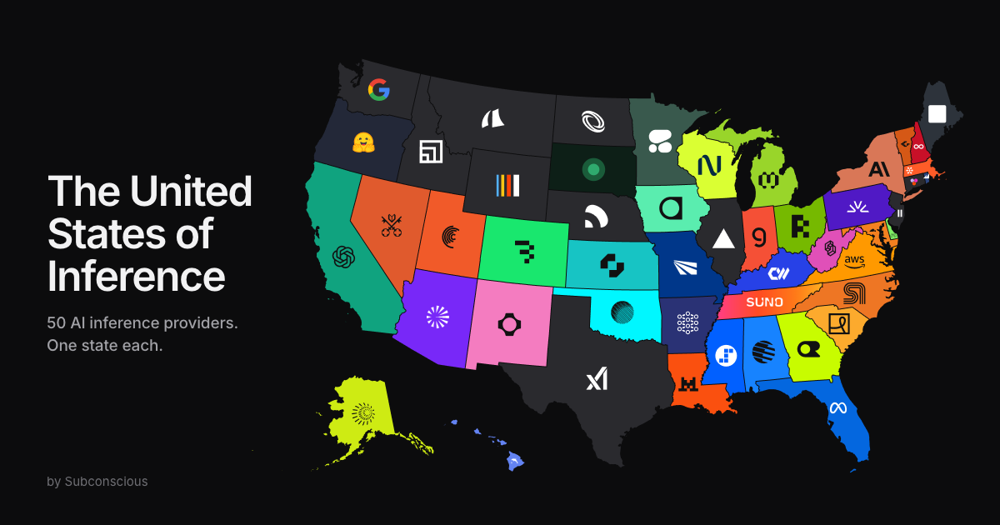

<div align="center">

<a href="https://subconscious-systems.github.io/united-states-of-inference/">
  
</a>

<h1>The United States of Inference</h1>

<p>50 AI inference providers. One state each.</p>

<p>
  <a href="https://subconscious-systems.github.io/united-states-of-inference/"></a>
  <a href="https://github.com/subconscious-systems/united-states-of-inference/deployments"></a>
  
  
  
  
</p>

<p>
  <a href="https://subconscious-systems.github.io/united-states-of-inference/"><b>Open the map</b></a>
  &nbsp;·&nbsp;
  <a href="https://subconscious-systems.github.io/united-states-of-inference/agents.html">Data for agents</a>
  &nbsp;·&nbsp;
  <a href="#the-map">The full list</a>
  &nbsp;·&nbsp;
  <a href="https://subconscious.dev">Subconscious</a>
</p>

</div>

---

There are so many inference providers. How do you tell them apart?

The United States of Inference gives each of 50 AI inference providers the US state it is most like. Not where it is based. Its ethos, what it is known for, what it does. Click a state to see who got it, why, and what sets that provider apart.

## Contents

- [Features](#features)
- [How to use it](#how-to-use-it)
- [The map](#the-map)
- [For agents and crawlers](#for-agents-and-crawlers)
- [Run it locally](#run-it-locally)
- [Change a state](#change-a-state)
- [Project layout](#project-layout)
- [Design notes](#design-notes)
- [Credits](#credits)

## Features

- Every state in its provider's brand colors, with the provider's logo on top
- A card for each state: the provider, a one-line reason, a tagline and what makes them different
- Search by provider with Command K (Ctrl K on Windows and Linux)
- Step through all 50 states with the arrow keys or the previous and next buttons
- Deep links to any state, like `#texas` or `#new-york`
- A phone layout with a bottom sheet and a Northeast zoom for the small states
- A "View all" list of every match
- Dark mode, with brand colors tuned so black logos still read
- Respects reduced motion
- Ships as plain HTML, CSS and JavaScript, with no framework and no build step

## How to use it

| Do this | To get this |
| --- | --- |
| Click or tap a state | Open its card |
| `←` `→` | Previous or next state, in alphabetical order |
| `⌘ K` / `Ctrl K` | Search by provider |
| `Esc` | Close the card or the search |
| Northeast (on phones) | Zoom in on New England and the Mid-Atlantic |
| View all | See every state and provider in one list |

## The map

States are in alphabetical order. The list is not a ranking.

<!-- readme:start -->
| State | Provider | Why |
| --- | --- | --- |
| [Alabama](https://subconscious-systems.github.io/united-states-of-inference/#alabama) | [Moonshot AI](https://www.moonshot.ai) | Huntsville engineers designed the Saturn V that carried Americans to the moon, which makes Rocket City the obvious home for a lab named after the trip. |
| [Alaska](https://subconscious-systems.github.io/united-states-of-inference/#alaska) | [Crusoe](https://www.crusoe.ai) | Alaska is oil rigs and off-grid cabins at the end of the road, and Crusoe got its start running GPUs on gas that oil wells used to burn off. |
| [Arizona](https://subconscious-systems.github.io/united-states-of-inference/#arizona) | [General Compute](https://www.generalcompute.com) | The desert once known for cactus now builds chip fabs, and General Compute runs inference on custom ASICs with no GPU in sight. |
| [Arkansas](https://subconscious-systems.github.io/united-states-of-inference/#arkansas) | [DeepInfra](https://deepinfra.com) | Walmart started in Arkansas on the promise of everyday low prices, and DeepInfra brings that energy to open models with a giant catalog and no minimums. |
| [California](https://subconscious-systems.github.io/united-states-of-inference/#california) | [OpenAI](https://openai.com) | Most of what feels normal today got tried in California first. ChatGPT is how most of the world met AI. |
| [Colorado](https://subconscious-systems.github.io/united-states-of-inference/#colorado) | [Baseten](https://www.baseten.co) | Every fourteener climb starts at base camp, and so does a lot of AI headed for production. |
| [Connecticut](https://subconscious-systems.github.io/united-states-of-inference/#connecticut) | [Together AI](https://www.together.ai) | Hartford got rich getting everyone to pool their risk. Together started out as a decentralized cloud pooling GPUs. |
| [Delaware](https://subconscious-systems.github.io/united-states-of-inference/#delaware) | [Modal](https://modal.com) | Over a million companies call Delaware home without ever setting foot there. Modal runs your code on GPUs without you ever setting foot on a server. |
| [Florida](https://subconscious-systems.github.io/united-states-of-inference/#florida) | [Meta](https://www.meta.com) | Nobody can predict Florida Man or Meta: Llama one year, Muse the next, a retired API in between. Your grandma probably thinks Muse is cute. |
| [Georgia](https://subconscious-systems.github.io/united-states-of-inference/#georgia) | [OpenRouter](https://openrouter.ai) | Atlanta’s Hartsfield-Jackson is the busiest airport in the country, and OpenRouter is where the AI industry changes planes. |
| [Hawaii](https://subconscious-systems.github.io/united-states-of-inference/#hawaii) | [Dolphin](https://dphn.ai) | Hawaii’s spinner dolphins swim wherever they want. Dolphin’s models say whatever they want, running on home GPUs scattered across a network. |
| [Idaho](https://subconscious-systems.github.io/united-states-of-inference/#idaho) | [Makora](https://www.makora.com) | Boise is home to Micron, which makes the memory stacked inside today’s GPUs. Makora’s agents rewrite the code running on those GPUs until it’s up to 5x faster. |
| [Illinois](https://subconscious-systems.github.io/united-states-of-inference/#illinois) | [Vercel AI Gateway](https://vercel.com/ai-gateway) | Every trip across America seems to connect through O’Hare. Every model call can connect through Vercel. |
| [Indiana](https://subconscious-systems.github.io/united-states-of-inference/#indiana) | [Groq](https://groq.com) | Built for tight, predictable latency, Groq belongs at the Indy 500, where the winning car holds its line for 500 miles. |
| [Iowa](https://subconscious-systems.github.io/united-states-of-inference/#iowa) | [Wafer](https://www.wafer.ai) | Iowa farmers brag about bushels per acre, and Wafer brags about tokens per second on the same weights everyone else runs. |
| [Kansas](https://subconscious-systems.github.io/united-states-of-inference/#kansas) | [Inception](https://www.inceptionlabs.ai) | A Kansas tornado turns a whole farm into noise in seconds. Mercury runs it in reverse: noise in, a whole answer out. |
| [Kentucky](https://subconscious-systems.github.io/united-states-of-inference/#kentucky) | [CoreWeave](https://www.coreweave.com) | Fort Knox guards the nation’s gold reserve, and CoreWeave guards the GPU reserve the biggest AI labs rent from. |
| [Louisiana](https://subconscious-systems.github.io/united-states-of-inference/#louisiana) | [Mistral](https://mistral.ai) | Louisiana still speaks a little French, and so does Europe’s frontier lab. |
| [Maine](https://subconscious-systems.github.io/united-states-of-inference/#maine) | [Thinking Machines](https://thinkingmachines.ai) | Mainers fix their own boats, plows and roofs. Thinking Machines built Tinker so you can fix up your own model without touching a GPU. |
| [Maryland](https://subconscious-systems.github.io/united-states-of-inference/#maryland) | [Cloudflare Workers AI](https://www.cloudflare.com/developer-platform/products/workers-ai/) | The NSA lives in Maryland. So does the company that sits in front of a big chunk of the internet. |
| [Massachusetts](https://subconscious-systems.github.io/united-states-of-inference/#massachusetts) | [Subconscious](https://www.subconscious.dev) | Home of the oldest modern marathon, the Boston Marathon. Subconscious builds Marathon models that keep agents going for hours. |
| [Michigan](https://subconscious-systems.github.io/united-states-of-inference/#michigan) | [Morph](https://morphllm.com) | Michigan gave the world the moving assembly line, where each specialist does one job at blistering speed, and Morph applies that idea to code edits. |
| [Minnesota](https://subconscious-systems.github.io/united-states-of-inference/#minnesota) | [Cohere](https://cohere.com) | Minnesota is where Target, 3M and General Mills keep their headquarters, a polite drive from Canada. Cohere is the Toronto lab that builds AI for companies exactly like them. |
| [Mississippi](https://subconscious-systems.github.io/united-states-of-inference/#mississippi) | [StepFun](https://stepfun.ai) | The Ole Miss Rebels love picking fights with bigger SEC programs. StepFun is a startup picking fights with China’s tech giants. |
| [Missouri](https://subconscious-systems.github.io/united-states-of-inference/#missouri) | [Infron](https://infron.ai) | St. Louis has the Gateway to the West. Infron is a gateway to 400+ models. |
| [Montana](https://subconscious-systems.github.io/united-states-of-inference/#montana) | [Armada](https://www.armada.ai) | Montana has ranches a hundred miles from the nearest data center. Armada ships the data center to the ranch. |
| [Nebraska](https://subconscious-systems.github.io/united-states-of-inference/#nebraska) | [Parasail](https://www.parasail.io) | Warren Buffett got rich in Omaha buying what everyone else overlooked, and Parasail turns overlooked GPU capacity into cheap batch inference. |
| [Nevada](https://subconscious-systems.github.io/united-states-of-inference/#nevada) | [Venice](https://venice.ai) | What happens in Vegas stays in Vegas, and Venice runs uncensored models without keeping your conversations. |
| [New Hampshire](https://subconscious-systems.github.io/united-states-of-inference/#new-hampshire) | [Refuseless](https://refuseless.com) | New Hampshire stamps Live Free or Die on every license plate, and Refuseless builds models that follow the motto. |
| [New Jersey](https://subconscious-systems.github.io/united-states-of-inference/#new-jersey) | [ElevenLabs](https://elevenlabs.io) | Edison recorded the first human voice in Menlo Park. ElevenLabs can now fake yours. |
| [New Mexico](https://subconscious-systems.github.io/united-states-of-inference/#new-mexico) | [fal](https://fal.ai) | Santa Fe is one of the biggest art markets in the country and Albuquerque keeps film crews busy, a fitting home for fal and its thousand-plus generative media models. |
| [New York](https://subconscious-systems.github.io/united-states-of-inference/#new-york) | [Anthropic](https://www.anthropic.com) | New York is the business capital of the world, plus millions of regular people upstate. Anthropic dominates enterprise AI and still serves millions of individuals with Claude. |
| [North Carolina](https://subconscious-systems.github.io/united-states-of-inference/#north-carolina) | [SambaNova](https://sambanova.ai) | NASCAR country loves heavy machines moving at absurd speed, and SambaNova pushes giant open models fast on its own dataflow chips. |
| [North Dakota](https://subconscious-systems.github.io/united-states-of-inference/#north-dakota) | [Boundless](https://boundless.network) | The prairie runs to the horizon in every direction, and Boundless tunes reserved capacity so you never hit the edge. |
| [Ohio](https://subconscious-systems.github.io/united-states-of-inference/#ohio) | [RunInfra](https://runinfra.ai) | The Wright brothers tested 200 wing designs in their Dayton bike shop before they ever left the ground. RunInfra tests your serving setup before it ships. |
| [Oklahoma](https://subconscious-systems.github.io/united-states-of-inference/#oklahoma) | [Particle.AI](https://particle.ai) | Oklahoma City invented the shopping cart so you could haul more for less effort. Particle hauls a million tokens for a quarter. |
| [Oregon](https://subconscious-systems.github.io/united-states-of-inference/#oregon) | [Hugging Face](https://huggingface.co) | Portland’s motto is Keep Portland Weird, and Hugging Face is the open-source town square where AI’s weirdest projects live. |
| [Pennsylvania](https://subconscious-systems.github.io/united-states-of-inference/#pennsylvania) | [Fireworks AI](https://fireworks.ai) | Philadelphia lit up the first Fourth of July with fireworks in 1777. They’ve been the main event ever since. |
| [Rhode Island](https://subconscious-systems.github.io/united-states-of-inference/#rhode-island) | [Sail Research](https://www.sailresearch.com) | Newport is America’s sailing capital, and Sail lets you pick a completion window and pay up to 85% less for waiting on the wind. |
| [South Carolina](https://subconscious-systems.github.io/united-states-of-inference/#south-carolina) | [Relace](https://relace.ai) | South Carolina’s beaches exist for relaxing, and Relace keeps inference cheap enough that you can. |
| [South Dakota](https://subconscious-systems.github.io/united-states-of-inference/#south-dakota) | [Luminal](https://luminal.com) | Mount Rushmore carved four presidents straight into granite, and Luminal compiles models straight into native GPU code. |
| [Tennessee](https://subconscious-systems.github.io/united-states-of-inference/#tennessee) | [Suno](https://suno.com) | Nashville has a songwriter on every barstool. Suno has one in every browser tab. |
| [Texas](https://subconscious-systems.github.io/united-states-of-inference/#texas) | [xAI](https://x.ai) | Everything is bigger in Texas, opinions included, and xAI is the lab that does things its own way and dares you to object. |
| [Utah](https://subconscious-systems.github.io/united-states-of-inference/#utah) | [Cerebras](https://www.cerebras.ai) | Land speed records get set on the Bonneville Salt Flats, and Cerebras posts the fastest published output speed of any public host. |
| [Vermont](https://subconscious-systems.github.io/united-states-of-inference/#vermont) | [GMI Cloud](https://www.gmicloud.ai) | Vermonters grow their own food and fix their own trucks. GMI Cloud owns the GPUs it runs on. |
| [Virginia](https://subconscious-systems.github.io/united-states-of-inference/#virginia) | [Amazon Bedrock](https://aws.amazon.com/bedrock/) | Virginia is for lovers. It’s also for defense contractors and US-East-1. Amazon Bedrock embodies this great state. |
| [Washington](https://subconscious-systems.github.io/united-states-of-inference/#washington) | [Google](https://ai.google.dev) | Seattle grows tech giants the way it grows moss. Google wrote the Transformer paper that every model on this map is built on. |
| [West Virginia](https://subconscious-systems.github.io/united-states-of-inference/#west-virginia) | [TypeSafe AI](https://typesafe.ai) | Jevons noticed that making coal cheaper to burn only made the world burn more of it, and West Virginia dug plenty. TypeSafe named its first model Jev, making the same bet on decisions. |
| [Wisconsin](https://subconscious-systems.github.io/united-states-of-inference/#wisconsin) | [Nebius](https://nebius.com) | Wisconsin was built by European immigrants who showed up and got to work, and Nebius is the Amsterdam neocloud doing the same in American AI. |
| [Wyoming](https://subconscious-systems.github.io/united-states-of-inference/#wyoming) | [Inference.net](https://inference.net) | With the smallest population in the country, Wyoming has room to spare, and Inference.net runs batch jobs on spare GPU capacity. |
<!-- readme:end -->

## For agents and crawlers

Everything on the page is also available as text.

| File | What it is |
| --- | --- |
| [`agents.md`](agents.md) | Every match, the reverse provider → state list, and each provider's tagline, bullets and website, in Markdown |
| [`agents.html`](https://subconscious-systems.github.io/united-states-of-inference/agents.html) | The same Markdown, as a page you can open in a browser |
| [`llms.txt`](llms.txt) | A summary in the [llms.txt](https://llmstxt.org) format |
| [`sitemap.xml`](sitemap.xml) and [`robots.txt`](robots.txt) | For search engines. All crawlers are welcome. |

The page itself carries Open Graph and Twitter card tags, a 1200×630 share image, and JSON-LD for the website, the article and the full list of providers. Without JavaScript, the page still has the full list in plain HTML.

## Run it locally

There is nothing to install.

```sh
git clone https://github.com/subconscious-systems/united-states-of-inference.git
cd united-states-of-inference
python3 -m http.server 4173
```

Then open http://localhost:4173. Any static file server works.

## Change a state

1. Edit the match in `data.js`. Each state maps to a provider id, a display name and a one-line reason.
2. Edit the provider in `logos/manifest.json`: logo file, colors, tagline, bullets and website.
3. Put the logo in `logos/`.
4. Regenerate the text files and the favicon:

   ```sh
   node scripts/build-meta.mjs
   node scripts/build-favicon.mjs
   ```

5. Bump the `?v=` numbers on the files you changed in `index.html` and `app.js`, so browsers don't serve old copies.
6. Push to `main`. GitHub Pages deploys it.

## Project layout

```
index.html             the page, plus the generated list and JSON-LD
styles.css             all styles
app.js                 the map, cards, search, zoom and keyboard controls
data.js                state → provider, with the reason for each
states.js              state shapes and logo positions
logos/                 provider logos and manifest.json
scripts/
  build-meta.mjs       writes agents.md, agents.html, llms.txt, sitemap.xml,
                       the list and JSON-LD in index.html, and the table in this README
  build-favicon.mjs    draws favicon.svg from the state colors
og.png                 share image
favicon.svg            the map in provider colors
```

## Design notes

- One typeface: Inter.
- No all-caps.
- Motion follows Emil Kowalski's guidelines: short, eased, and only where it helps.
- Each reason is two short sentences: a fact about the state, then a fact about the provider.
- Logos and colors come from each provider's own site.

## Credits

Made by [Subconscious](https://subconscious.dev).

Provider names, logos and colors belong to their owners and are used here to identify them. Spotted something out of date? Open an issue or a pull request.
